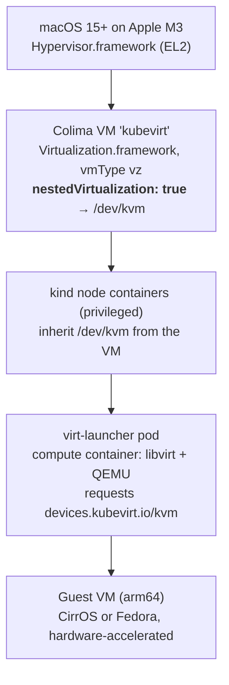
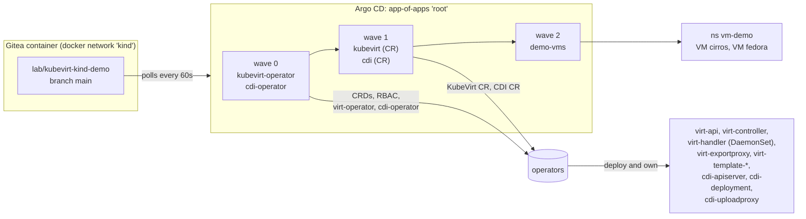
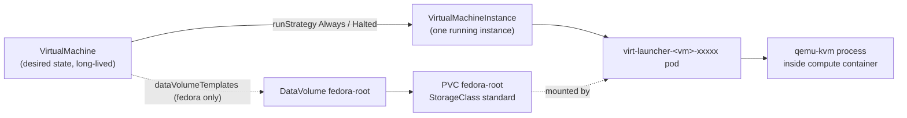
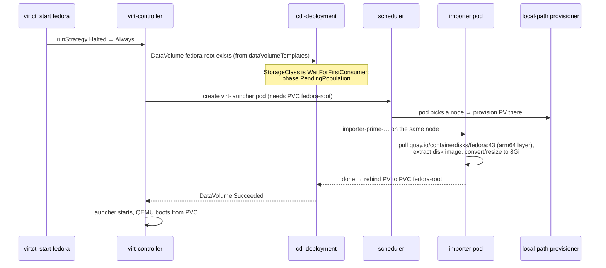
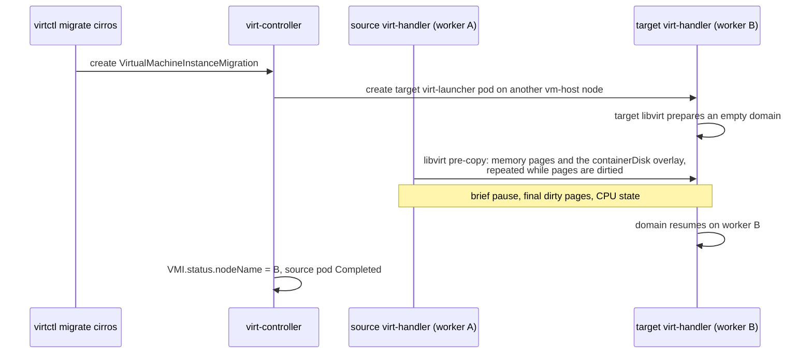

# KubeVirt on kind: Demo Flows Explained

**What happens to each VM at every step, what KubeVirt does underneath, and how to show it to an audience.**

This is a companion to the [main README](../README.md). Script names refer to this repository. Behaviour labelled *observed* was seen on the reference build: a MacBook Pro M3, Colima `vz` with nested virtualisation, kind v0.33 with Kubernetes 1.35.8, KubeVirt v1.9.0, and CDI v1.66.1.

---

## 0. How to use this document

| If you want to… | Read |
|---|---|
| Understand how a VM can run inside a container on a Mac | §1 |
| Understand the platform pieces and how Argo CD installs them | §2 |
| Understand the two demo VMs | §3 |
| Set up your screen before presenting | §4 |
| Log in to a VM from a Mac app (credentials, VNC, SSH) | §4.5 |
| Run a specific flow and know what to say | §5 |
| Diagnose something that went wrong | §6 |
| Draw it on a whiteboard or slides | §7 |
| Prepare for audience questions | §8 |

---

## 1. The virtualisation stack: four layers deep

The whole demo depends on one question: **is there a usable `/dev/kvm` at the bottom of the stack?**



| Layer | What it is | What can go wrong | How the lab checks it |
|---|---|---|---|
| macOS + M3 | Apple Silicon EL2 virtualisation. From M3 onwards, with macOS 15, a guest can be given its own virtualisation extensions | M1 and M2 can't nest, and neither can macOS 14 or earlier | `00-prereqs.sh` checks the chip and the macOS version |
| Colima VM | A Linux arm64 VM created through Apple's Virtualization.framework. The `--nested-virtualization` flag exposes KVM inside it | The profile was created without the flag. `vmType` can't be changed later | `01-colima.sh` runs `test -c /dev/kvm` over `colima ssh` and fails fast |
| kind nodes | Privileged containers. A privileged container sees the host's devices, so it doesn't need `extraMounts` | Rootless or non-privileged node runtimes | `02-cluster.sh` runs `docker exec <node> test -c /dev/kvm` on every node |
| virt-launcher | A per-VM pod running QEMU under libvirt. With `useEmulation: false`, it asks the device plugin for `/dev/kvm` | virt-handler isn't running (see §6.1), so no node advertises `devices.kubevirt.io/kvm` | `status.sh` shows each node's allocatable `devices.kubevirt.io/kvm` |

**Why Docker Desktop and Podman can't be used:** their Linux VMs don't expose nested virtualisation, so there is no `/dev/kvm`. KubeVirt can still run there with `useEmulation: true`, using QEMU TCG (software CPU emulation). That works, but boot times go from seconds to minutes, and guests in this lab hit timeouts.

**Why arm64 guests only:** KVM runs guest instructions directly on the host CPU, so the guest must use the host's architecture. KubeVirt 1.9 adds an alpha `CrossArchitectureVirtualization` gate for running x86 guests under TCG. It's slow and out of scope here.

---

## 2. The platform: what Argo CD installs, and in what order



### 2.1 Why there are two apps per component

KubeVirt and CDI each follow the **operator + custom resource** pattern:

1. **The operator app** (wave 0) applies the upstream release manifest: Namespace, CRDs, RBAC and the operator Deployment. It's a kustomize remote resource pinned to a release URL, so bumping the version is a one-line change in Git.
2. **The CR app** (wave 1) applies a single `KubeVirt` or `CDI` object. The operator reads it and **creates every other component itself**: virt-api, virt-controller, the virt-handler DaemonSet, webhooks, and more CRDs. Argo CD never sees those objects directly.

The CR can't be applied before its CRD exists. Sync waves alone don't enforce this: since Argo CD 1.8, a parent app doesn't wait for a child Application to become healthy. `config/argocd-values.yaml` restores that behaviour with three Lua health checks:

| Health check | Healthy when |
|---|---|
| `argoproj.io/Application` | The child app reports Healthy, so a wave really waits for the previous one |
| `kubevirt.io/KubeVirt` | `status.phase == Deployed` |
| `cdi.kubevirt.io/CDI` | `status.phase == Deployed` |

So wave 2 (the VMs) starts only after KubeVirt reports `Deployed`. That's why a broken virt-handler (§6.1) shows up as *"VMs never appear"*.

### 2.2 Sync options that matter

| Setting | Where | Why |
|---|---|---|
| `ServerSideApply=true` | All apps | The KubeVirt and CDI CRDs exceed the 256 KB `last-applied-configuration` annotation limit of client-side apply |
| `SkipDryRunOnMissingResource=true` | All apps | Lets a dry-run pass when a CRD from an earlier wave is still being registered |
| `ignoreDifferences` on `/spec/runStrategy` | demo-vms | `virtctl start`/`stop` changes `spec.runStrategy`. That's an operational action, and self-heal mustn't undo it |
| `ignoreDifferences` with `managedFieldsManagers: [cdi-operator]` | cdi-operator | cdi-operator rewrites its own CRD after install. Without this, the app is permanently OutOfSync (*observed*) |

### 2.3 Components you'll see

| Component | Kind | Runs on | Job |
|---|---|---|---|
| `virt-operator` | Deployment ×2 | any node | Reconciles the `KubeVirt` CR into all other components, and handles upgrades |
| `virt-api` | Deployment ×2 | any node | Webhooks (validation, mutation) and the subresource API behind `virtctl` (`console`, `vnc`, `pause`, `migrate`) |
| `virt-controller` | Deployment ×2 | any node | Cluster-wide brain. Turns VMs into VMIs and VMIs into virt-launcher pods, and orchestrates migrations |
| `virt-handler` | DaemonSet | every schedulable node (here, the workers) | Node agent. Runs the KVM device plugin, labels nodes, and talks to each launcher's libvirt to start, stop and migrate domains |
| `virt-exportproxy` | Deployment | any node | Serves VM disk exports. Not used in the flows |
| `virt-template-apiserver` / `-controller` | Deployment | any node | VM templates. The `Template` gate is Beta, so it's on by default in 1.9 |
| `cdi-apiserver`, `cdi-deployment`, `cdi-uploadproxy` | Deployments | any node | DataVolume API, the import controller, and the upload endpoint |

---

## 3. Anatomy of the demo VMs

Both VMs live in namespace `vm-demo` (`gitops/workloads/demo-vms/`).

### 3.1 The object chain



| Object | Lifetime | Analogy |
|---|---|---|
| `VirtualMachine` (VM) | Until deleted. Survives stop and start | A Deployment (desired state) |
| `VirtualMachineInstance` (VMI) | One boot. Deleted on stop | A Pod (a running instance) |
| virt-launcher pod | Same as the VMI | The sandbox the VMI runs in |
| `DataVolume` | Until deleted. Owned by the VM | "Import this image into a PVC, then hand it over" |

### 3.2 `cirros`: the fast, migratable one

| Field | Value | Why |
|---|---|---|
| Disk | `containerDisk: quay.io/kubevirt/cirros-container-disk-demo:v1.9.0` | The disk image is shipped as an OCI image. It's ephemeral: every boot starts clean |
| Memory / CPU | 256Mi guest, 1 core | Boots in seconds with KVM |
| Network | Pod network, `masquerade` binding | The VM is NATed behind the pod IP. Migration-safe |
| `evictionStrategy` | `LiveMigrate` | Draining the node moves the VM instead of killing it |
| `runStrategy` | `Always` | Argo CD syncs it and the VM is up |

### 3.3 `fedora`: the persistent one

| Field | Value | Why |
|---|---|---|
| Disk | `dataVolumeTemplates` → registry import of `quay.io/containerdisks/fedora:43` into an 8Gi PVC | Shows CDI turning an image into a persistent disk |
| Memory / CPU | 2Gi, 2 cores | A real distribution |
| cloud-init | `fedora` / `kubevirt`, sets `/etc/motd` | Lab-only credentials for `virtctl console` |
| `evictionStrategy` | `None` | The RWO local-path PVC pins it to one node, so it can't be live-migrated |
| `runStrategy` | `Halted` | Nothing is imported until Flow 2 starts it |

### 3.4 What a virt-launcher pod actually contains (*observed*)

This is the most useful slide in the deck. It shows that a VM is "just a pod" without hand-waving.

| Part | Observed value | Meaning |
|---|---|---|
| Container `compute` | `virt-launcher-monitor … --hypervisor kvm --ovmf-path /usr/share/AAVMF` | QEMU under libvirt, booting arm64 guests through UEFI (AAVMF) firmware |
| Resource requests | `devices.kubevirt.io/kvm: 1`, `tun: 1`, `vhost-net: 1`, `memory: 652Mi`, `cpu: 100m` | The KVM request proves hardware virtualisation. 652Mi = the 256Mi guest + ~396Mi overhead (annotation `kubevirt.io/memory-overhead-bytes: 415236096`) |
| Security context | `runAsUser: 107`, `runAsNonRoot: true`, adds only `NET_BIND_SERVICE`, drops `ALL` | The VM process isn't root and isn't privileged |
| Init `guest-console-log` (`restartPolicy: Always`) | Native sidecar running `virt-tail` | Streams the guest serial console into the pod log, so `kubectl logs -c guest-console-log` shows the boot |
| Init `volumecontainerdisk` | Image `cirros-container-disk-demo` | Delivers the container disk. In 1.9 the disk is mounted through a Kubernetes **image volume** (`volumes[].image`) |
| Node selector (added by KubeVirt) | `kubernetes.io/arch: arm64`, `kubevirt.io/schedulable: "true"`, `machine-type.node.kubevirt.io/virt: "true"`, plus our `lab.kubevirt/role: vm-host` | Labels written by virt-handler's node labeller decide where VMs can run |
| Readiness gate | `kubevirt.io/virtual-machine-unpaused` | A paused VM makes its pod NotReady, so Services stop sending it traffic |
| Annotations | `pre/post.hook.backup.velero.io/command: virt-freezer --freeze/--unfreeze` | KubeVirt adds Velero hooks by default: guest filesystems are frozen during backups. This links to the Velero DR lab |

---

## 4. Presenter setup

### 4.1 Screen layout

Three panes (tmux, iTerm2 or Terminal). Run this in every pane first:

```bash
cd ~/git/kubevirt-kind-demo && export PATH="$PWD/bin:$PATH" DOCKER_CONTEXT=colima-kubevirt
```

```
┌──────────────────────────────────┬──────────────────────────────────┐
│ VMs and VMIs                     │ Pods with node placement         │
│ watch -n2 kubectl --context      │ watch -n2 kubectl --context      │
│  kind-kubevirt-lab get           │  kind-kubevirt-lab -n vm-demo    │
│  vm,vmi,vmim,dv -n vm-demo       │  get pods -o wide                │
├──────────────────────────────────┴──────────────────────────────────┤
│ driver: ./demo/flow-1-lifecycle.sh                                  │
└─────────────────────────────────────────────────────────────────────┘
```

**Optional browser tabs:**

| Tab | How | Shows |
|---|---|---|
| Argo CD | `kubectl --context kind-kubevirt-lab -n argocd port-forward svc/argocd-server 8080:80` → <http://localhost:8080> | The app-of-apps tree and the waves. Click `kubevirt` to show the CR going Healthy |
| Gitea | <http://127.0.0.1:3300> | The Git source of truth, outside the cluster |
| Guest console | `virtctl --context kind-kubevirt-lab -n vm-demo console cirros` | A real login prompt. Use `cirros` / `gocubsgo` and press `Ctrl+]` to leave |

### 4.2 Pre-flight checklist (about 10 minutes before)

```bash
colima status --profile kubevirt            # running
./scripts/status.sh                         # all apps Synced/Healthy, KubeVirt+CDI Deployed,
                                            # devices.kubevirt.io/kvm = 1k on both workers, cirros Running
```

- **Pre-pull the Fedora import.** Run Flow 2 once before the talk, then reset it (§4.4). The import downloads about 500 MB, which is the slowest step in the demo.
- **Close Docker Desktop** if it's running. With two Linux VMs on a 32 GB Mac, the importer and Fedora boot can slow down from memory pressure.
- **Rehearse the console exit.** `Ctrl+]` leaves `virtctl console`, and nothing else does.

### 4.3 Running order and timing

| # | Flow | Live time (expected) | Audience message |
|---|---|---|---|
| 1 | Lifecycle (`flow-1-lifecycle.sh`) | 4–5 min | A VM is a pod. It's hardware-accelerated, and you manage it with Kubernetes verbs |
| 2 | DataVolume (`flow-2-datavolume.sh`) | 3–8 min (import dominates; under 1 min if pre-pulled) | Disks are PVCs. CDI turns images into disks with no hand-built qcow2 |
| 3 | Live migration (`flow-3-live-migration.sh`) | 2–3 min | Nodes can be drained without downtime, using standard Kubernetes eviction |

`./demo/run-all.sh` runs all three in order. `DEMO_AUTO=1` skips the "press enter" pauses for dry runs.

### 4.4 Reset between rehearsals

```bash
# Fedora back to "never imported" - Argo re-creates the VM, Halted
virtctl --context kind-kubevirt-lab -n vm-demo stop fedora
kubectl --context kind-kubevirt-lab -n vm-demo delete vm fedora    # its DataVolume and PVC are owned by it and go with it
./scripts/push.sh --refresh                                        # or wait about 60s for self-heal
```

Deleting a VM that Git declares is the one imperative step here, and Argo CD self-heal puts it straight back. That's worth pointing out to the audience. CirrOS needs no reset. For a full rebuild, run `./scripts/teardown.sh && ./scripts/up.sh` (the Colima VM is kept).

### 4.5 Connecting to the VMs from Mac apps

| VM | Username | Password | Source |
|---|---|---|---|
| `fedora` | `fedora` | `kubevirt` | cloud-init `userData` in `vm-fedora.yaml` (`password`, `chpasswd: { expire: false }`, `ssh_pwauth: true`) |
| `cirros` | `cirros` | `gocubsgo` | Built into the CirrOS image |

| Method | Mac app | Command | Works for | Notes |
|---|---|---|---|---|
| Serial console | Terminal | `virtctl … console <vm>` | Both, best for CirrOS | Text only. Exit with `Ctrl+]`. Also visible read-only through `kubectl logs <launcher-pod> -c guest-console-log` |
| VNC (auto) | TigerVNC (`brew install --cask tigervnc-viewer`), Chicken, RealVNC Viewer | `virtctl … vnc <vm>` | fedora | virtctl finds the viewer in `/Applications` and launches it on a random local port |
| VNC (manual) | Any VNC client | `virtctl … vnc <vm> --proxy-only --port 5901`, then connect to `127.0.0.1:5901` | fedora | Leaves the proxy running for whichever viewer you choose |
| SSH | Terminal, Termius, Royal TSX | `virtctl … port-forward vm/<vm> 2222:22`, then `ssh -p 2222 <user>@127.0.0.1` | Both | Keep the port-forward running. Use a different local port per VM |
| Browse objects | Freelens / Lens | Custom Resources → `kubevirt.io` | Both | YAML, events and launcher pods. No console |

(`…` = `--context kind-kubevirt-lab -n vm-demo`, with `bin/` on `PATH` for `virtctl`.)

**Copy-paste commands.** Run one block per Terminal tab. Each `virtctl` command stays in the foreground while the session is open. There are no inline comments, so the blocks are safe to paste into zsh.

Setup, once per tab:

```bash
cd ~/git/kubevirt-kind-demo
export PATH="$PWD/bin:$PATH"
```

Install a VNC viewer, once:

```bash
brew install --cask tigervnc-viewer
```

Start fedora if it is still Halted, and wait for `Running` (Ctrl+C to stop watching):

```bash
virtctl --context kind-kubevirt-lab -n vm-demo start fedora
kubectl --context kind-kubevirt-lab -n vm-demo get vmi fedora -w
```

Serial console for cirros. Log in as `cirros` / `gocubsgo`, and press `Ctrl+]` to exit:

```bash
virtctl --context kind-kubevirt-lab -n vm-demo console cirros
```

Serial console for fedora. Log in as `fedora` / `kubevirt`:

```bash
virtctl --context kind-kubevirt-lab -n vm-demo console fedora
```

VNC for fedora: TigerVNC opens automatically. Leave the VNC password blank, then log in as `fedora` / `kubevirt`:

```bash
virtctl --context kind-kubevirt-lab -n vm-demo vnc fedora
```

VNC with any other viewer app: start only the proxy, then point the viewer at `127.0.0.1:5901`:

```bash
virtctl --context kind-kubevirt-lab -n vm-demo vnc fedora --proxy-only --port 5901
```

Or launch TigerVNC yourself, in a second tab. The app was named `TigerVNC Viewer <version>.app` before TigerVNC 1.16, so use whichever name `ls /Applications | grep -i tiger` shows:

```bash
open -a TigerVNC --args 127.0.0.1:5901
```

SSH to fedora. Tab 1 holds the port-forward:

```bash
virtctl --context kind-kubevirt-lab -n vm-demo port-forward vm/fedora 2222:22
```

Tab 2 logs in with password `kubevirt`:

```bash
ssh -o StrictHostKeyChecking=no -o UserKnownHostsFile=/dev/null -p 2222 fedora@127.0.0.1
```

SSH to cirros, using a different local port so both can be open at once:

```bash
virtctl --context kind-kubevirt-lab -n vm-demo port-forward vm/cirros 2223:22
```

Then, in a second tab, log in with password `gocubsgo`:

```bash
ssh -o StrictHostKeyChecking=no -o UserKnownHostsFile=/dev/null -p 2223 cirros@127.0.0.1
```

Read-only boot log, with no login needed:

```bash
kubectl --context kind-kubevirt-lab -n vm-demo logs -f -l kubevirt.io/vm=fedora -c guest-console-log
```

`UserKnownHostsFile=/dev/null` stops "host key changed" errors. The forwarded port stays the same, but the host key changes every time a VM is rebuilt. Use it for lab VMs only.

**How VNC reaches the guest:** virtctl opens a WebSocket to the `vnc` subresource on virt-api. virt-api relays it to the virt-handler on the VM's node, which connects to the VNC socket QEMU exposes inside the virt-launcher pod. Nothing is published on a node port, and access is governed by RBAC on the `virtualmachineinstances/vnc` subresource. On arm64, the screen is a virtio-gpu framebuffer that KubeVirt attaches automatically.

**Why macOS Screen Sharing can't be used:** the built-in client refuses VNC servers that have no password, and KubeVirt's VNC endpoint has no password. Authentication happens at the Kubernetes API instead ([kubevirt#4207](https://github.com/kubevirt/kubevirt/issues/4207)).

**On stage:** VNC on `fedora` makes the "it's a real VM" point visually: the boot messages, then a `fedora login:` prompt. The serial console on CirrOS is quicker for the live-migration timestamp loop in Flow 3.

---

## 5. The flows, step by step

Column guide: **Cmd** is what the script runs. **KubeVirt** is what happens underneath. **Screen** is where to point. **Say** is a suggested line.

### Flow 1: "A VM is just a pod" (`demo/flow-1-lifecycle.sh`)

**Goal:** prove the VM is hardware-accelerated and is managed like any other workload.

| # | Cmd | KubeVirt | Screen | Say |
|---|---|---|---|---|
| 1 | Wait for `vmi/cirros` Ready, then print the VMI summary (`jq/vmi-summary.jq`) | virt-controller created the launcher pod. virt-handler on that node told the pod's libvirt to define and start the domain | Left pane: VMI `Running`, its node and pod IP | "Argo CD synced a `VirtualMachine` object, and KubeVirt turned it into a running VM." |
| 2 | `get pod -l kubevirt.io/vm=cirros -o wide` | Nothing new | Right pane: `virt-launcher-cirros-xxxxx`, 2/2 or 3/3 Ready | "The VM runs inside this pod. The scheduler placed it. It has a pod IP. Requests, limits and quotas all apply." |
| 3 | `jq/launcher-kvm.jq` on the pod | Nothing new | Driver: `compute container requests devices.kubevirt.io/kvm = 1` | "This is the proof. The pod asked the device plugin for `/dev/kvm`. Under emulation that line would say *none*." |
| 4 | `virtctl pause vm cirros` | virt-api → virt-handler → libvirt `virDomainSuspend`. The vCPUs stop, but memory stays resident | VMI `Paused` condition True. Pod goes **NotReady** because of the readiness gate | "Paused, not stopped: the RAM is still there. The pod drops out of Service endpoints automatically." |
| 5 | `virtctl unpause vm cirros` | libvirt `virDomainResume` | Pod Ready again | "Unpause resumes the VM exactly where it stopped." |
| 6 | `virtctl stop cirros` | Sets `spec.runStrategy: Halted`. virt-controller deletes the VMI, then the pod is torn down. The VM object remains | VMI gone, pod Terminating, `vm/cirros` shows `Stopped` | "The VM is the long-lived intent, and the VMI is one boot. Stop deletes the instance, not the definition." |
| 7 | `virtctl start cirros` | `runStrategy: Always` → new VMI → new pod, which may land on the other worker | New pod name, maybe a new node | "Start creates a fresh instance. CirrOS is a container disk, so it boots clean again." |
| 8 | (Optional) `virtctl console cirros` | Serial console over a WebSocket: virt-api → virt-handler → the launcher's console socket | Guest login prompt | "That's a real kernel booting on the M3's CPU, three virtualisation layers down." |

**GitOps tension worth calling out:** in steps 6 and 7, `virtctl` changed `spec.runStrategy` on an object Argo CD owns. Show the `demo-vms` app staying **Synced**: its `ignoreDifferences` treats run state as an operational concern, not configuration drift. Without that setting, self-heal would restart a VM you had just stopped.

### Flow 2: Persistent disks with CDI (`demo/flow-2-datavolume.sh`)

**Goal:** show that VM disks are PVCs, and that CDI handles importing images.



| # | Cmd | KubeVirt / CDI | Screen | Say |
|---|---|---|---|---|
| 1 | `virtctl start fedora` | `runStrategy: Always`. The VM controller sees that the DataVolume isn't ready and holds the VMI back | `dv/fedora-root` appears as `PendingPopulation` or `WaitForFirstConsumer` | "The disk doesn't exist yet. CDI won't import until it knows which node the VM lands on, because local storage is node-pinned." |
| 2 | Polls `jq/dv-progress.jq` every 10s | The importer pod pulls the registry image, writes it to a **prime** PVC, then rebinds the PV to `fedora-root` | Progress `0% → 100%`. An `importer-prime-…` pod appears in the right pane | "This is CDI's populator pattern: import into a scratch PVC, then swap the volume in. The VM only ever sees a complete disk." |
| 3 | `get pvc fedora-root` | Nothing new | `Bound`, 8Gi, StorageClass `standard` | "Ordinary PVC. Snapshots, backups and quotas all apply. Velero can back it up like any other PVC." |
| 4 | Wait for `vmi/fedora` Ready | The launcher pod mounts the PVC as a raw block or file disk and QEMU boots it, with cloud-init from a NoCloud disk | VMI Running | "cloud-init set the password and motd, just like on a public cloud." |
| 5 | (Optional) `virtctl console fedora`. Log in as `fedora` / `kubevirt`, run `echo hi > ~/proof`, exit, then stop and start | The PVC persists across VMI lifecycles | `~/proof` still exists after the restart | "Compare with CirrOS in Flow 1: the container disk resets, the PVC disk doesn't. Pick per workload." |

**Why the importer picks arm64:** CDI's registry importer pulls the image variant that matches the platform it runs on. The importer runs on an arm64 node, so it gets the arm64 Fedora image. `02-cluster.sh` checks the manifest list in advance.

### Flow 3: Live migration (`demo/flow-3-live-migration.sh`)

**Goal:** move a running VM between nodes with no restart, which is the basis for node maintenance and upgrades.



| # | Cmd | KubeVirt | Screen | Say |
|---|---|---|---|---|
| 1 | Record `vmi/cirros` `.status.nodeName` | Nothing new | e.g. `kubevirt-lab-worker2` | "Here's where it is now." |
| 2 | `virtctl migrate cirros` | Creates a `VirtualMachineInstanceMigration` (`vmim`). virt-controller schedules a **second** launcher pod on the other worker | Right pane: two virt-launcher pods, one per node | "For a moment the VM has two pods: the source running, and the target waiting for it." |
| 3 | Wait for the `vmim` phase `Succeeded` | Pre-copy migration over the pod network, using KubeVirt's migration mTLS certificates | `vmim` phases: `Scheduling → Scheduled → PreparingTarget → TargetReady → Running → Succeeded` | "Memory streams across while the guest keeps running. Only the final switch-over pauses it, briefly." |
| 4 | Compare the nodes | Source pod → `Completed`. VMI now reports the new node, with `migrationState.completed: true` | `jq/vmi-summary.jq` shows the new node and *migrated: yes* | "Same VMI, same IP inside the guest, new host. Nothing in the guest noticed." |

**Make it visible:** before step 2, open `virtctl console cirros` in a third pane and start `while true; do date; sleep 1; done`. Through the migration, the timestamps keep coming with at most a sub-second gap. Afterwards, the console session reconnects to the new node.

**What the workload-update strategy adds:** the KubeVirt CR sets `workloadUpdateMethods: [LiveMigrate]`. When you bump KubeVirt in Git, the operator live-migrates running VMs onto new launcher images instead of restarting them. That's the same mechanism this flow shows.

**Why `fedora` can't do this:** its disk is an RWO local-path PVC on one node. Live migration needs the disk reachable from both nodes, which means RWX storage (Ceph or ODF, NFS, Longhorn), or KubeVirt's newer storage-migration path. The lab sets `evictionStrategy: None` on fedora, so a node drain won't hang on it.

---

## 6. Troubleshooting

### 6.1 virt-handler crash-loops: `too many open files` (*observed on first build*)

**Symptom:** `kubevirt` app stuck Progressing. `kubectl get kubevirt` shows `Deploying`. virt-handler pods are 0/1 with restarts, and wave 2 (the VMs) never syncs. virt-operator logs repeat `Waiting on daemonset virt-handler to roll over`.

**Cause:** virt-handler's log ends with:

```
{"level":"fatal","msg":"Failed to create an inotify watcher","reason":"too many open files"}
panic: Failed to create an inotify watcher
```

`fs.inotify.max_user_instances` in the Colima VM defaults to **128**. The limit applies to the whole VM, so kubelet, containerd and every pod across all three kind nodes draw on that one budget. virt-handler opens several certificate watchers at start-up and runs out.

**Fix:** `01-colima.sh` now raises the limit on every run, because the setting is lost when the VM restarts:

```bash
colima ssh --profile kubevirt -- sudo sysctl -w fs.inotify.max_user_instances=8192 fs.inotify.max_user_watches=1048576
```

After raising it, delete the virt-handler pods to skip the CrashLoopBackOff delay. KubeVirt went from `Deploying` to `Deployed` in about 30 s, and Argo CD then synced the VMs on its own.

### 6.2 Other failure modes

| Symptom | Likely cause | Check / fix |
|---|---|---|
| `01-colima.sh` dies: `/dev/kvm missing` | Profile created without nested virt, or an M1/M2 Mac | `colima delete --profile kubevirt` then rerun. On M1/M2, set `useEmulation: true` in Git |
| Nodes show `devices.kubevirt.io/kvm: 0` or none | virt-handler not Ready on that node | §6.1, then `kubectl -n kubevirt logs ds/virt-handler` |
| VMI stuck `Scheduling`, event `Insufficient devices.kubevirt.io/kvm` | Same as above | Same as above |
| `cdi-operator` app OutOfSync forever | Operator rewrites its own CRD | Already handled by `ignoreDifferences` (§2.2) |
| DataVolume stuck `PendingPopulation` | VM not started: WaitForFirstConsumer is waiting for a consumer | `virtctl start fedora` |
| Importer pod `CrashLoopBackOff` / `ImagePullBackOff` | quay.io unreachable, or no arm64 variant | `docker manifest inspect quay.io/containerdisks/fedora:43 \| jq -r -f jq/image-arch.jq` |
| Migration `Failed`: no target node | Only one worker is schedulable, or memory is short on the target | `kubectl get nodes -l kubevirt.io/schedulable=true` and `kubectl describe vmim` |
| Argo CD apps `Unknown` / repo errors | Gitea container not running, or not on the `kind` network | `docker ps --filter name=gitea`, then `./scripts/03-gitea.sh` |
| `virtctl vnc`: `no supported VNC app found for darwin` | No TigerVNC, Chicken or RealVNC app in `/Applications` | `brew install --cask tigervnc-viewer`, or use `--proxy-only` with any viewer |
| Screen Sharing asks for a password and won't connect | The built-in macOS client requires VNC authentication | Use TigerVNC or RealVNC (§4.5) |
| VNC window for cirros stays black | CirrOS writes its console to the serial port, not the framebuffer | `virtctl … console cirros` |
| `fedora` login rejected | cloud-init still running on first boot | Wait about 1 min, then retry. `kubectl logs <launcher> -c guest-console-log` shows cloud-init progress |
| `accepts 1 arg(s), received N` | zsh passed an inline `# comment` as arguments | Remove trailing comments, or `setopt interactivecomments` in `~/.zshrc` |
| Everything slow, Mac swapping | Docker Desktop and Colima both running | Quit Docker Desktop, or lower `COLIMA_MEMORY_GIB` |

---

## 7. Illustrations for slides and whiteboards

### 7.1 One-slide architecture

```
 ┌────────────────────────── MacBook Pro M3 · macOS 15 ───────────────────────────┐
 │ Colima VM (vz, nested virt) ─ /dev/kvm                                         │
 │ ┌──────────────── kind: kubevirt-lab ──────────────────────────────────────┐   │
 │ │ control-plane            worker                    worker2               │   │
 │ │ argocd                   virt-handler              virt-handler          │   │
 │ │ virt-api/controller      ┌───────────────┐         ┌───────────────┐     │   │
 │ │ virt-operator            │ virt-launcher │ ──mig─▶ │ virt-launcher │     │   │
 │ │ cdi-*                    │  qemu-kvm ▶VM │         │  qemu-kvm ▶VM │     │   │
 │ │                          └───────────────┘         └───────────────┘     │   │
 │ └──────────────────────────────────────────────────────────────────────────┘   │
 │  gitea (container) ◀── Argo CD polls ── git push from ~/git/kubevirt-kind-demo │
 └────────────────────────────────────────────────────────────────────────────────┘
```

### 7.2 VM vs pod vocabulary

| Kubernetes | KubeVirt | Note |
|---|---|---|
| Deployment | VirtualMachine | Desired state, survives restarts |
| Pod | VirtualMachineInstance + virt-launcher pod | One running instance |
| `kubectl scale --replicas=0` | `virtctl stop` / `runStrategy: Halted` | |
| Container image | containerDisk | Ephemeral root disk |
| PVC | DataVolume → PVC | Persistent disk, populated by CDI |
| Pod eviction | Live migration (`evictionStrategy: LiveMigrate`) | Drain without downtime |
| `kubectl logs` | `kubectl logs -c guest-console-log` / `virtctl console` | Guest serial console |

### 7.3 State through the three flows

| After… | cirros | fedora | PVCs | Migrations |
|---|---|---|---|---|
| `up.sh` | Running (worker A) | Stopped | none | 0 |
| Flow 1 | Running (A or B, new pod) | Stopped | none | 0 |
| Flow 2 | Running | Running, imported | `fedora-root` 8Gi Bound | 0 |
| Flow 3 | Running (the other worker) | Running | unchanged | 1 Succeeded |

---

## 8. Audience Q&A crib

| Question | Answer |
|---|---|
| "Is this really hardware virtualisation on a Mac?" | Yes, on M3 or later with macOS 15+. The launcher pod requests `devices.kubevirt.io/kvm` and libvirt runs with `--hypervisor kvm`. On M1/M2, Docker Desktop or Podman, you'd need `useEmulation: true` (QEMU TCG), which is much slower. |
| "Why would I run VMs on Kubernetes at all?" | One control plane, RBAC model, network, storage and GitOps pipeline for containers and the VMs you can't containerise yet. It's the migration path off a separate hypervisor estate. OpenShift Virtualization is this same KubeVirt. |
| "Is the VM privileged?" | No. The QEMU process runs as UID 107, non-root, drops all capabilities except `NET_BIND_SERVICE`, and gets KVM through a device-plugin resource. The privileged component is the node agent, virt-handler. |
| "How does networking work?" | By default, through the pod network with `masquerade`: the VM is NATed behind its pod IP, so Services, NetworkPolicy and Ingress apply unchanged. Multus plus bridge or SR-IOV attach VMs to VLANs when they need L2. |
| "Can I live-migrate any VM?" | Only if its disks are reachable from the target node: container disks or RWX volumes. RWO local disks (our `fedora`) can't be migrated. The VMI's `LiveMigratable` condition tells you. |
| "What about Windows or x86 images?" | Not on this Mac. KVM requires the guest to match the host architecture (arm64 here). Windows on ARM would need its own licensing and images. On x86 clusters it's routine. |
| "How do backups work?" | VMs are CRs plus PVCs, so Velero/OADP or CSI snapshots apply. KubeVirt even pre-annotates launcher pods with `virt-freezer` hooks for consistent guest-filesystem freezes. KubeVirt 1.9 also adds `VirtualMachineBackup` CRDs. |
| "How are KubeVirt upgrades handled?" | Bump the version in Git. virt-operator rolls the components, then `workloadUpdateMethods: [LiveMigrate]` moves running VMs onto new launcher images with no guest restart. |
| "How do I get a screen or shell on the VM?" | `virtctl console` (serial), `virtctl vnc` (graphics, through TigerVNC or RealVNC on a Mac), or `virtctl port-forward` plus SSH. All of them go through the Kubernetes API and RBAC, so nothing is exposed on node ports. |
| "Does Kyverno or Pod Security get in the way?" | Launcher pods meet most baseline controls but need `NET_BIND_SERVICE` and device resources, and virt-handler is privileged. Exempt the `kubevirt` namespace and allow-list launcher pods. Kyverno isn't installed in this lab. |
| "Production differences?" | Real bare-metal or nested-capable nodes, RWX storage (ODF/Ceph) for migration, Multus for networking, dedicated migration networks, `instancetype`/`preference` objects instead of hand-sized VMs, and monitoring via the bundled Prometheus rules. |
